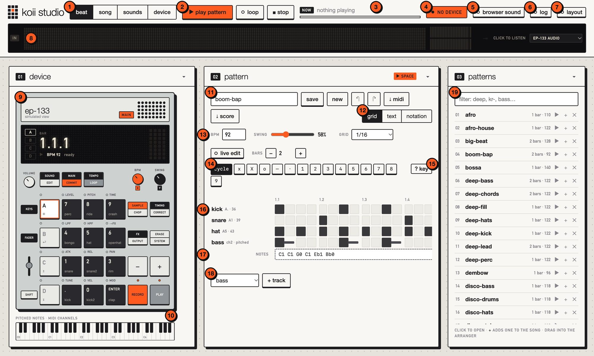
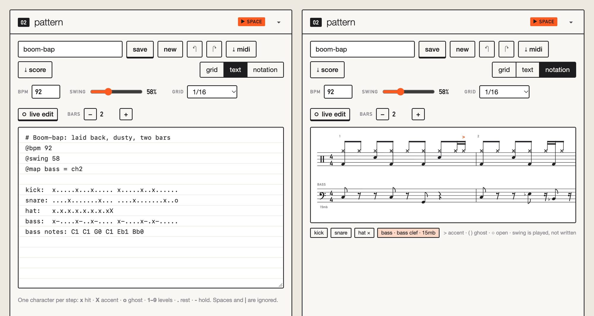
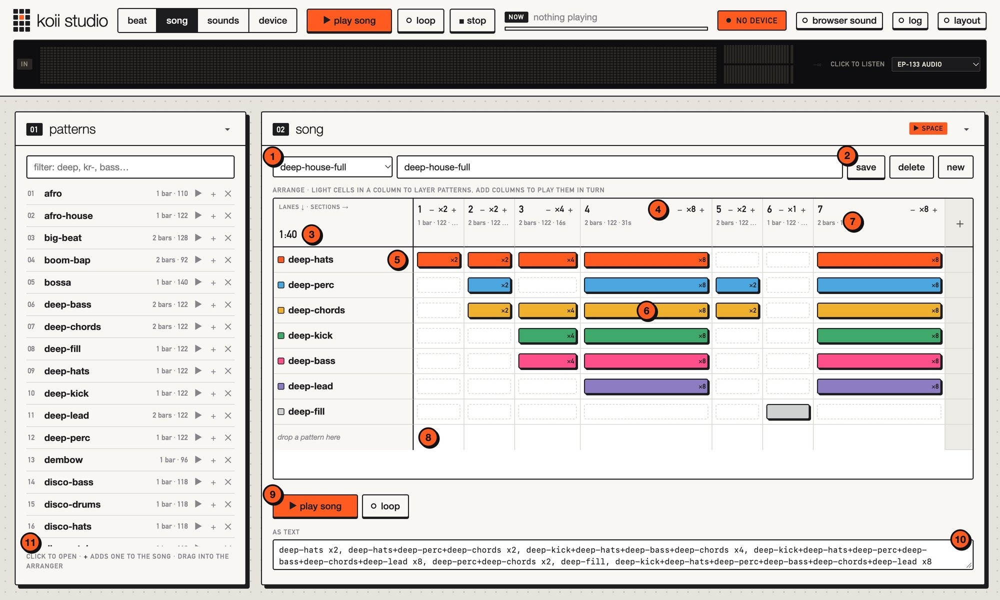
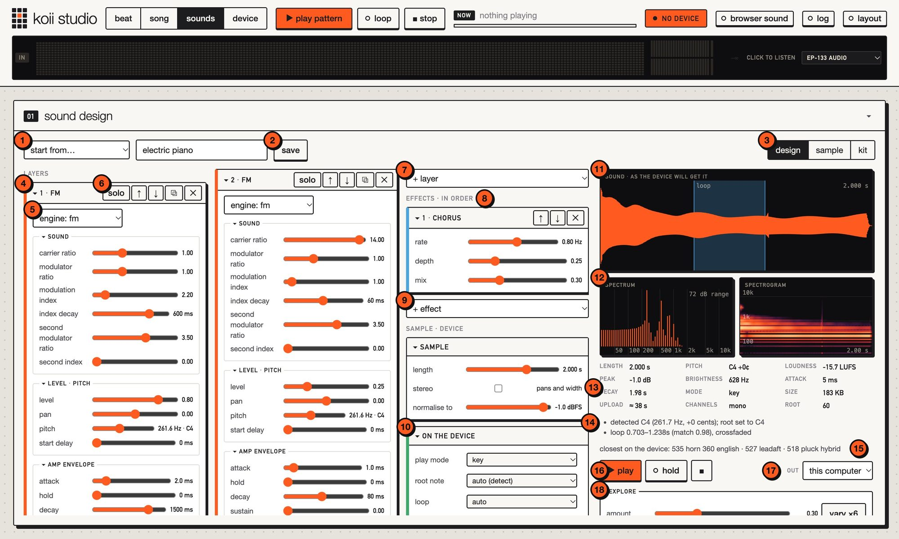
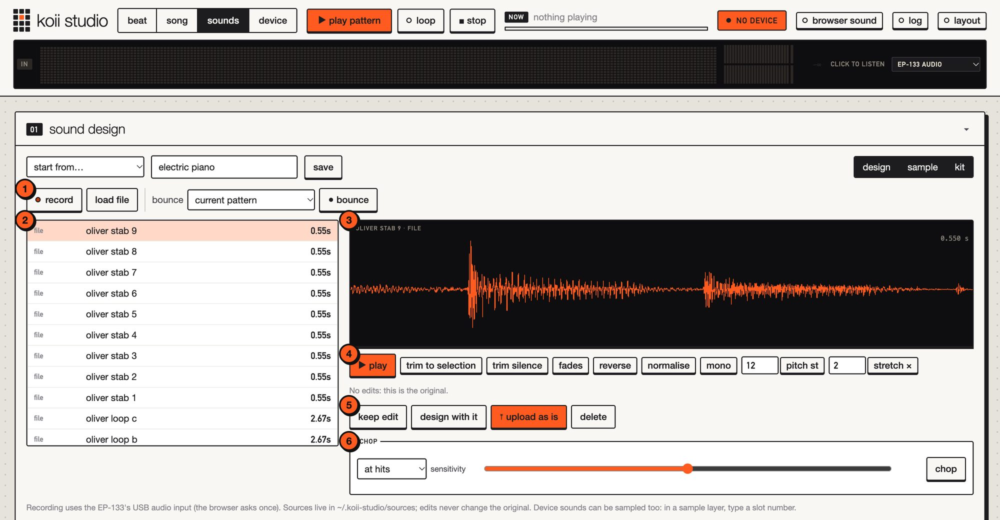
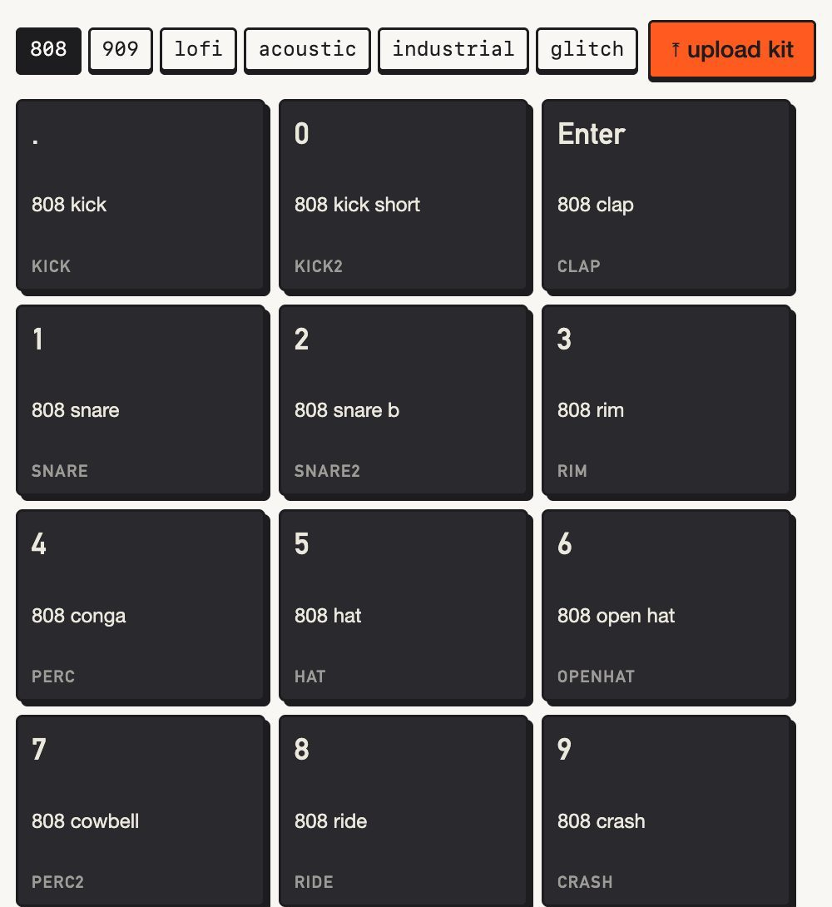
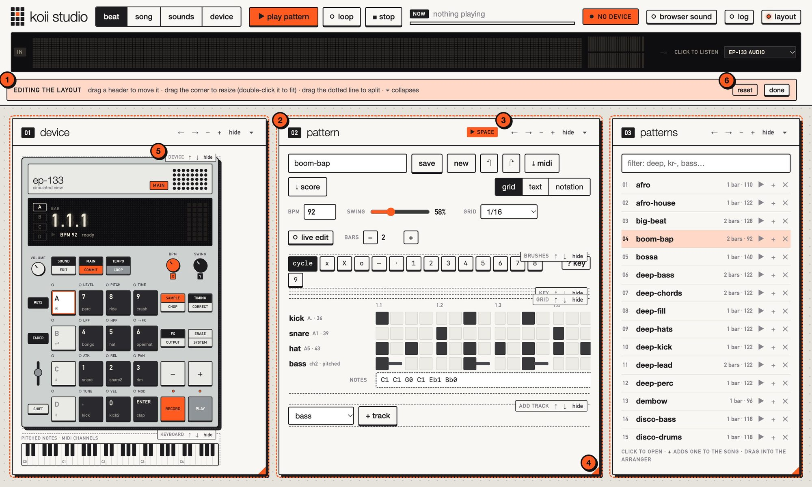

# A tour of koii studio

The page at **http://127.0.0.1:8133** (ask Claude to `open_visualiser`, or run `koii-studio`)
has four views, one per job: **Beat** to make a pattern, **Song** to arrange patterns,
**Sounds** to make sounds and **Device** to see and change what's on the EP-133. Everything
Claude does shows up here as it happens, and everything you do here, Claude can see.

The numbers in each screenshot match the list under it.

## Beat: make a pattern

**The top bar** is the same in every view:

1. **Views:** beat, song, sounds and device. Each has its own address (`#beat`, `#song`, …),
   so you can bookmark one.
2. **Transport:** ▶ plays what the view is about (here the pattern; in Song, the song), and
   pressing it again stops. **loop** repeats it, **stop** stops everything. Space does the
   same as ▶.
3. **Now playing:** what's playing and how far through it is.
4. **Connection:** whether the EP-133 is connected over USB. Click it to connect, or to
   choose the *browser simulator* when there's no device.
5. **Browser sound:** play the simulator's synthesised voices in this browser too, so you
   can hear patterns with no device.
6. **Log:** every command Claude has run, with **Open in editor** for the patterns it wrote.
7. **Layout:** move, resize and hide the parts of each view (see [Your own layout](#your-own-layout)).
8. **Live strip:** what the EP-133 is actually playing, from its USB audio output: spectrum,
   stereo meters, peak level. It only listens. Click it to start or stop listening.

**The pattern:**

9. **The simulated EP-133:** pads light orange as notes play and blue when you press them on
   the real device, and the screen counts bars and beats. Click a pad to hear it; with the
   EP-133 connected, that also opens the pad's settings in the Device view.
10. **Pitched notes:** the keyboard lights up the notes of basslines and chords as they play.
11. **Name and file:** save under a name, start a new pattern, undo and redo (⌘Z, ⇧⌘Z), and
    download it as a MIDI file or as a score (MusicXML) for notation software.
12. **Three views of one pattern:** the step **grid**, the **text** notation, and **notation**
    (sheet music). They're always the same pattern; change one and the others follow.
13. **Tempo, swing, step length and bars.** Turn on **live edit** and every change to a
    looping pattern comes in at the end of the current pass.
14. **Brushes:** what a click paints. `x` is a hit, `X` an accent, `o` a ghost note, `–` holds
    the note before, `·` is a rest, `1`–`9` set the level, and **cycle** steps through rest,
    hit, accent and ghost on each click. Shift-drag to hold a note, right-click to erase.
15. **? key:** what every symbol and colour in the grid means.
16. **Tracks:** one row per sound, named by kit alias (`kick`), pad (`A.`) or channel (`ch2`).
    Click a name to hear it, double-click to rename it.
17. **Notes:** a pitched track's notes, one per hit, in order: `C1 C1 G0 C1 Eb1 Bb0`.
18. **Add a track:** choose a sound and press **+ track**.
19. **Your patterns:** filter by name, click one to open it, ▶ to play it, **+** to add it to
    the song in Song view, ✕ to delete it (press twice).

The same pattern as text and as sheet music:

The text is exactly what Claude writes: one character per step, one line per sound. The
full format is in [NOTATION.md](NOTATION.md).

## Song: arrange patterns

1. **Songs:** open a saved song, or start one with **new**.
2. **Name and save,** or delete the song.
3. **Length:** how long the whole song plays.
4. **Sections** play left to right. Each one's **− / +** sets how many times it repeats.
   Drag a section's header to move it. Sections are as wide as they play, so the song's
   shape shows at a glance.
5. **Lanes,** one per pattern. Move a lane up or down with its arrows; the top lit lane sets
   a section's tempo.
6. **Lit cells** play together: light several in one column to layer patterns (here hats,
   percussion, chords, kick, bass and lead at once). Click a cell to light or clear it.
7. **+** adds a section.
8. **Drop a pattern** on the empty lane at the bottom to give it a lane of its own, or on a
   cell to layer it there.
9. **Play** the song, and **loop** it.
10. **As text:** the same song as an arrangement, `deep-hats x2, deep-kick+deep-bass x4, …`.
    Type here and the grid follows.
11. **Drag from the list** of patterns into the arranger, or press a pattern's **+** to add it
    as a new section.

## Sounds: make sounds

The Sounds view has three tabs: **design** builds a sound from scratch, **sample** works
with recordings, and **kit** makes twelve drum sounds at once.

### Design

1. **Start from** an empty design, one of 33 presets, or a design you've saved.
2. **Name and save** the design to your library.
3. **Tabs:** design, sample and kit.
4. **Layers** are mixed together, up to six. Each one is an engine (analog, FM, pluck, modal,
   metal, additive, noise or sample) with its own envelopes, pitch, filter and LFOs.
5. **Engine:** what makes the layer's sound. Its controls change to match.
6. **Layer tools:** solo, move up or down, duplicate, delete.
7. **+ layer** adds one.
8. **Effects, in order:** EQ, drive, lofi, compressor, transient, chorus, delay, reverb and
   width, applied top to bottom.
9. **+ effect** adds one.
10. **On the device:** how the EP-133 will play it: play mode, root note and loop. *Auto*
    detects the pitch and finds a seamless loop when it's uploaded.
11. **The sound as the device will get it,** at its own 46,875 Hz, with the loop marked.
12. **Spectrum and spectrogram.**
13. **Analysis:** length, pitch, loudness, brightness, attack, decay, size and how long the
    upload will take.
14. **What upload will set:** the detected root note and the loop it found.
15. **Closest on the device:** the sounds already on the EP-133 that sound most like this one.
16. **Play** it, **hold** it (sustains on the loop, like a held pad in key mode), or stop it.
17. **Out:** play it through this computer or straight out of the EP-133.
18. **Explore:** six variations at once (lock the controls you want to keep), or morph
    towards another sound. Further down the column, **upload to device** puts it in an empty
    slot.

### Sample

1. **Get a sound:** record the EP-133's output, load a WAV file, or bounce a pattern (the
   device plays it once while the page records it as a tempo-synced loop).
2. **Sources:** everything recorded, loaded or chopped. Your originals are never changed.
3. **The waveform.** Drag across it to select part of it.
4. **Edits:** trim to the selection or the silence, fades, reverse, normalise, mono, pitch
   (in semitones) and stretch.
5. **Keep the edit** as a new source, **design with it** (opens it as a sample layer in the
   designer), **upload as is**, or delete it.
6. **Chop** it at the hits, or into equal slices, ready to upload together.

### Kit

Choose a style (808, 909, lofi, acoustic, industrial or glitch) and koii studio designs
twelve sounds laid out like group A's pads. Click a pad to hear it, double-click to open it
in the designer, and **upload kit** to put all twelve in twelve empty slots in a row.

## Device: what's on the EP-133

The Device view shows the open project and all 48 of its pads (click one to change its
sound, channel, play mode or level, live), the sample packs, and the device's sample
library with backups. It needs the EP-133 connected over USB, so its screenshot is still to
come.

## Your own layout

1. **Layout mode** is on: press **layout** in the top bar, and **done** when you've finished.
2. **Drag a module's header** to move it.
3. **Module tools:** move left or right, make it narrower or wider, or hide it.
4. **Drag the corner** to resize a module, or double-click it to fit its contents.
5. **The parts inside a module** can be moved up or down or hidden too.
6. **reset** puts the view back as it was.

Each view's layout is kept separately, in this browser. On a window at least 1100 × 600, each
view fits on one screen, and long lists scroll inside their module.
