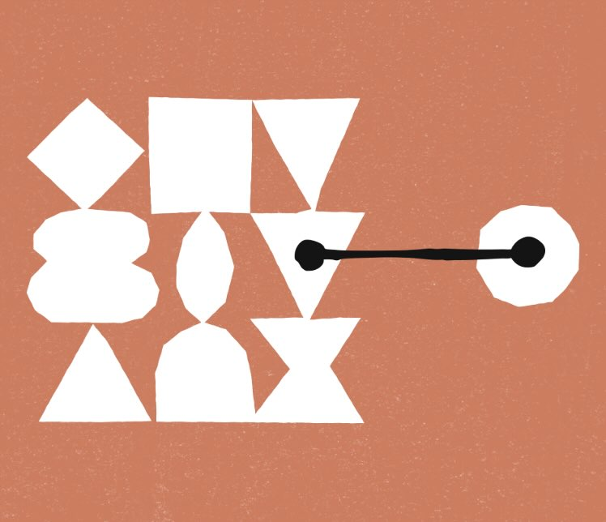
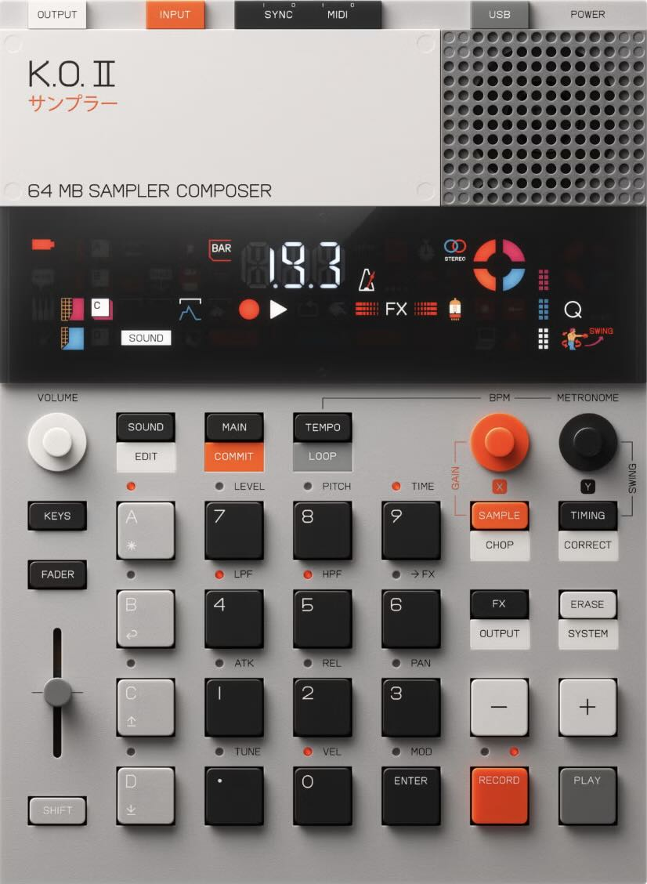

# MCP Interface for Teenage Engineering EP-133 K.O. II



An MCP server that lets Claude make beats and songs with you on an EP-133 K.O. II over MIDI.
You talk about the music; Claude writes patterns in a small, strict text notation, plays
them on your device, loops them while you iterate, and arranges them into songs.

```
@bpm 92
@swing 58

kick:  x... ..x. x... ....
snare: .... x... .... x..o
hat:   x.x. x.x. x.x. x.xX
```

## Install

Requires Python 3.9–3.12 and an EP-133 connected over USB-C. (Python 3.13 works too, but
`python-rtmidi`, which talks to the MIDI hardware, has no prebuilt wheels for it yet and
will compile from source.)

```bash
git clone https://github.com/benjaminr/mcp-koii.git
cd mcp-koii
uv venv --python 3.12 .venv
uv pip install -r requirements.txt

# Add to Claude Desktop
mcp install koii_server.py --name koii -e .

# Or try it in the MCP inspector
mcp dev koii_server.py -e .
```

For Claude Code: `claude mcp add koii -- /path/to/mcp-koii/.venv/bin/python /path/to/mcp-koii/koii_server.py`.

## Making music

Ask Claude something like *"connect to my K.O. II and let's make a slow boom-bap beat"*,
or use the `make_a_beat` prompt. A typical session:

1. `connect()`: finds the EP-133 automatically. `open_visualiser()` shows it all live.
2. Claude writes a pattern, checks it with `check_pattern`, and runs `play(..., loop=True)`.
3. You say what to change. Each new `play` switches **at the end of the current loop**,
   so the groove never stops while you iterate.
4. `save_pattern("verse", ...)` keeps versions you like (saved to `~/.koii/library.json`).
5. `save_song("track", "intro x2, verse x4, verse+bassline x4, chorus x8, outro")` and
   `play("track")`.
6. `export_midi("track")` writes a `.mid` file for your DAW.

## The visualiser

The server also runs a live page at **http://127.0.0.1:8133** (ask Claude to `open_visualiser`).
It shows everything that happens, whoever does it: Claude's tool calls, your edits, and
pads you press on the device.

- **KO II simulator:** pads light as notes play (orange) and when you press them on the
  device (blue); the display shows bar and beat. Click a pad to hear it.
- **Pattern editor** with three views of the same pattern:
  - **Grid:** a step sequencer. Paint with brushes (hit, accent, ghost, levels 1–9, hold,
    rest); shift-drag holds, right-click erases. Add tracks and bars, type basslines. **? key**
    explains every symbol and colour.
  - **Text:** the notation itself, checked as you type, with clickable errors.
  - **Notation:** sheet music, with a drum staff and a bass or treble staff for pitched tracks.
- **Loop building:** Play, Loop and Stop; turn on **Live edit** and every change switches
  in at the end of the current pass. Undo and redo (⌘Z / ⇧⌘Z); Space plays and stops.
- **Library and arranger:** open, play, loop and delete saved patterns, build songs on a
  timeline, and download `.mid` files.
- **Activity:** each MCP call Claude makes, with **Open in editor** for its patterns.
- **Live strip:** the EP-133 is also a USB audio device, so a strip across the top bar
  shows what it actually plays: spectrum as LED columns, stereo meters with peak hold and
  clip lights, and the peak level. It only listens. Once the browser may use the EP-133's
  audio input, listening starts by itself whenever the EP-133 is plugged in, and it never
  falls back to your microphone. Click the strip to stop or start it (stopping keeps it
  off on later visits), or switch it to the browser simulator's voices.
- **Samples:** the EP-133's sample library (all 999 slots), with search, waveforms,
  metadata, play-on-device, WAV download and backups with progress. This uses the device's
  private file protocol as reverse-engineered by
  [ep-series-sysex](https://github.com/kmorrill/ep-series-sysex); close TE's EP Sample Tool
  while using it, since the device handles one file session at a time.
- **Sound design:** a layered synthesiser and sampler that renders at the device's own
  46,875 Hz (the same engine Claude uses):
  - **Design:** up to six layers (analog, FM, pluck, modal, metal, additive, noise and
    sample engines), each with envelopes, a pitch drop, a sweeping filter and LFOs, into
    an effects chain (EQ, drive, lofi, compressor, transient, chorus, delay, reverb,
    width).
  - **Analysis and preview:** waveform, spectrum and spectrogram, pitch, loudness and
    brightness, and the closest sounds already on the device. Play it here or through the
    EP-133's own output.
  - **Exploring:** variations with locks, morphing towards another sound, and a library
    of saved designs.
  - **Sample:** record the EP-133, bounce a pattern to a tempo-synced loop, load files,
    edit (trim, fades, reverse, pitch, stretch) and chop at the hits.
  - **Kit:** twelve sounds in a style (808, 909, lofi, acoustic, industrial, glitch).
  - **Upload:** detects the root note and fine tune, finds a seamless loop and sets the
    play mode, so pads play in tune and sustain. Uploads need a complete backup, never
    touch sounds koii didn't upload, and are checked against the device's own checksum.
    See **[SOUND_DESIGN.md](SOUND_DESIGN.md)**.
- **Your own layout:** press **layout** to move modules (drag a header), resize them (drag
  the corner) and hide them; reorder or hide the parts inside them; and drag the line
  between two-column areas. **▾** collapses a module at any time. The layout is kept in
  this browser; **reset** goes back to the default.
- **No device?** Choose *Browser simulator* (top right) and the page plays synthesised
  drums and bass itself.

To run it without Claude: `python -m koii.visualiser` (or `koii-visualiser`). It connects to
the EP-133 on start if it's plugged in (`--no-connect` to skip that). Settings:
`KOII_WEB_PORT` (default 8133; the next free port is used if it's taken) and `KOII_WEB=off`
to disable it. It only listens on localhost and ignores commands from other websites.

## The notation

Full spec: **[NOTATION.md](NOTATION.md)**. The short version:

| | |
|-|-|
| `kick: x...x...` | one line per sound; **one character = one step** (a 16th note) |
| `x` `X` `o` `1`–`9` | hit, accent, ghost, level 1–9 |
| `.` `-` | rest, hold the previous note |
| spaces, `\|` | ignored; use them to group beats |
| `@bpm` `@swing` `@grid` | tempo, swing (50–75), step length |
| `@map bass = ch2` + `bass notes: C1 Eb1 G0` | pitched lines on a MIDI channel |
| `verse x4, chorus+bass x2` | arrangements: repeat with `xN`, layer with `+` |

Sounds are named with kit aliases (`kick`, `snare`, `hat`, `oh`, `clap`, …), pad labels
(`A1`, `B.`, `CEnter`) or MIDI notes. `show_kit` shows them all and `set_alias` adds your
own. Mistakes come back as errors with line and column, e.g.
`line 2: 'snare' has 15 steps, which doesn't divide the longest track 'kick' (16 steps)`.

## Device setup

Drums need no setup. For basslines and melodies, assign the pad to a MIDI channel in
Sound Edit (OS 2.0+). Dynamics (`o`, `X`, `1`–`9`) work with no setup. Details, with
sources and what has been checked on hardware, are in **[DEVICE.md](DEVICE.md)**.

## Tools

| Tool | |
|------|-|
| `list_midi_ports`, `connect`, `disconnect`, `status` | connection |
| `check_pattern` | validate and show a pattern without playing (no device needed) |
| `play`, `stop` | play pattern text, saved names, layers or arrangements; loop and switch seamlessly |
| `audition` | hear one sound or pad |
| `save_pattern`, `save_song`, `show`, `list_library`, `delete` | the library |
| `export_midi` | write a `.mid` file (no device needed) |
| `export_musicxml` | write sheet music for a pattern (MuseScore, Dorico, Sibelius…) |
| `list_device_sounds`, `play_sample` | the samples stored on the EP-133 |
| `backup_device`, `cancel_backup` | copy every sample (WAV) and project to `~/.koii/backups` |
| `upload_sample`, `delete_upload` | put a WAV on the device (converted to 46,875 Hz), or remove koii's own uploads |
| `sound_presets`, `sound_design_schema` | starting points, and every engine, effect and setting |
| `design_sound`, `vary_sound`, `morph_sounds` | render and describe a design (shown in the visualiser), make variations, morph |
| `save_design`, `list_designs` | the design library, plus recorded and loaded sources |
| `upload_design`, `change_sound_settings` | put a design on the device as an instrument (root, loop, play mode); change an upload's settings in place |
| `make_kit`, `kit_status`, `chop_source` | twelve-sound kits in a style; slices from a recording; uploads to slots in a row |
| `open_visualiser` | open the live browser view |
| `show_kit`, `set_alias`, `remove_alias`, `list_factory_sounds` | the kit |

Prompts: `notation_guide`, `device_guide`, `sound_design_guide`, `make_a_beat`, `design_a_sound`.

## Development

```bash
uv pip install -r requirements-dev.txt
.venv/bin/python -m pytest
```

The tests check the notation from several sides: parser fuzzing, generated patterns whose
sheet music must match what plays, MusicXML re-read by [music21](https://www.music21.org/),
and a round trip through the browser editor's own JavaScript (needs Node).

The code is in `koii/`: `notation` (parser), `sequence` (timing, swing, arrangements,
MIDI files), `player` (background playback), `library` (persistence), `studio` (ties it
together), `events` (live updates), `visualiser` (the web server, with the page in
`koii/static/`) and `server` (MCP tools). Device files: `files` (the SysEx file protocol),
`backup` and `samples`. Sound design: `koii/synth/` (`schema` is the design format,
`engine` and `dsp` render it, `analysis`, `instrument` for device settings, `variation`,
`edit`, `presets`, and the `designs`, `sources` and `factory` stores), joined up by
`sound_design`. Set `KOII_HOME` to keep the library, designs and sources somewhere else.

## Acknowledgements

- [Teenage Engineering](https://teenage.engineering/) for the EP-133 K.O. II.
- [Anthropic](https://www.anthropic.com/) for Claude and the Model Context Protocol.
- [MIDO](https://mido.readthedocs.io/) for MIDI handling.
